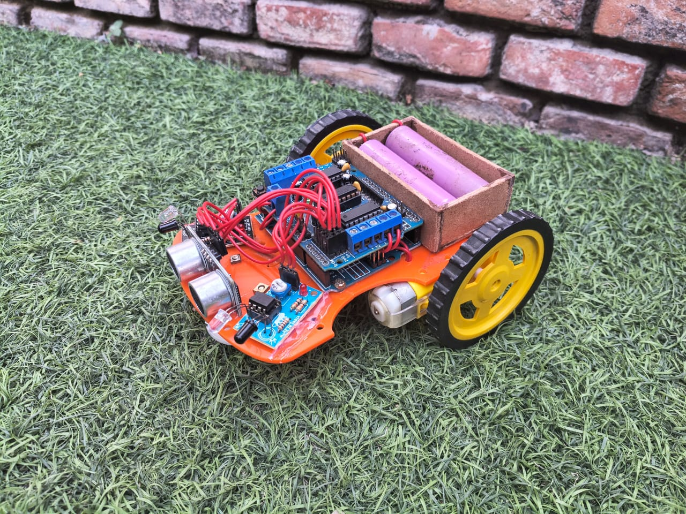
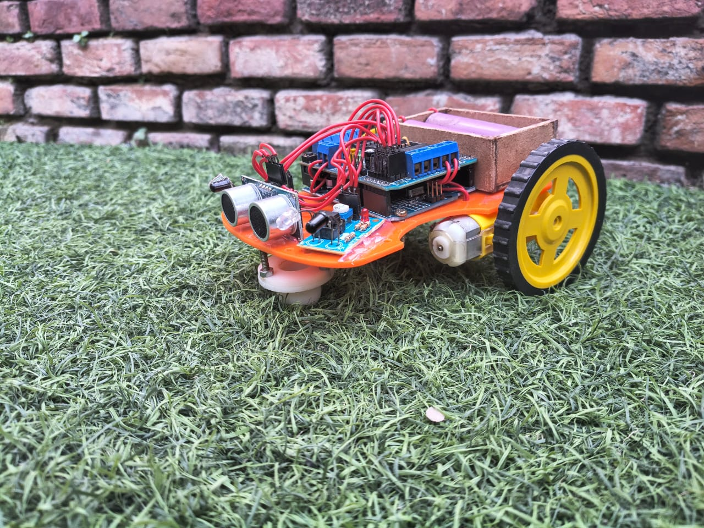
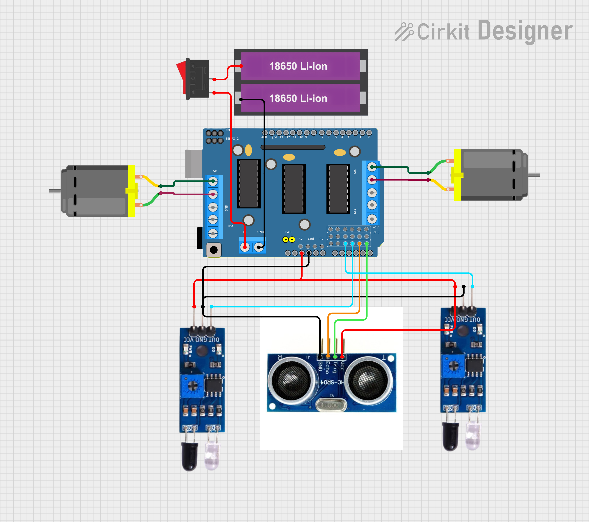

# Object Follower Robot

<p align="center">
  
</p>

<p align="center">
  <strong>Arduino • Embedded Systems • Robotics</strong><br>
  An Arduino-based mobile robot designed to follow a nearby object using distance sensing and directional inputs.
</p>

<p align="center">
  
  
  
</p>

## Project Overview

The **Object Follower Robot** is a robotics project developed collaboratively by **Ashwani Patel** and **Aman Pratap Singh**. It uses an ultrasonic sensor to measure the distance to an object and two digital inputs to help determine movement direction. A motor-driver setup controls four DC motors to move the robot forward, turn, or stop.

The repository includes the Arduino firmware, circuit image, robot photos, demo videos, and supporting documentation.

## Demo and Hardware

### Robot Prototype

<p align="center">
  
  
</p>

### Circuit Diagram

<p align="center">
  
</p>

### Demonstration Videos

The demonstration videos are available in [`media/demo-videos/`](media/demo-videos/):

- [Demo video 1](media/demo-videos/object-follower-demo-01.mp4)
- [Demo video 2](media/demo-videos/object-follower-demo-02.mp4)
- [Demo video 3](media/demo-videos/object-follower-demo-03.mp4)

GitHub may display video files differently depending on the browser. If an embedded preview is unavailable, open a video link to view it.

## Features

- Ultrasonic distance measurement using the `NewPing` library.
- Two DC gear motors controlled through an `AFMotor`-compatible motor shield.
- Forward movement based on the configured distance band and digital input states.
- Left and right turning based on directional input states.
- Motor release/stop behavior for specified distance conditions.
- Serial Monitor output for distance and input readings.

## Hardware

The exact component models should be confirmed against the physical build before replicating the project.

- Arduino UNO R3
- Adafruit Motor Shield
- Two DC gear motors and robot chassis
- Ultrasonic distance sensor SR04
- Two digital IR sensor
- Suitable motor power supply, connecting wires, and mounting hardware

See [`hardware/components.md`](hardware/components.md) and [`hardware/pinout.md`](hardware/pinout.md) for details.

## Pin Configuration

| Function | Pin / Channel |
|---|---|
| Right sensing input | A2 |
| Left sensing input | A3 |
| Ultrasonic trigger | A4 |
| Ultrasonic echo | A5 |
| Motor 1 | Motor Shield M1 |
| Motor 2 | Motor Shield M2 |
| Motor 3 | Motor Shield M3 |
| Motor 4 | Motor Shield M4 |

## Working Principle

1. The ultrasonic sensor measures the distance to an object in front of the robot.
2. The controller reads the two digital sensing inputs.
3. The firmware evaluates the distance and input states.
4. Depending on the conditions, it commands the motors to move forward, turn left, turn right, or release.
5. Distance and input values are printed to the Serial Monitor at **9600 baud**.

### Current Control Logic Notes

The firmware's forward condition combines the distance range with the case where both digital inputs are HIGH using an OR condition. Therefore, both inputs HIGH can trigger forward motion even when the distance is outside the normal 3–15 cm band. Also, the current conditional structure should be reviewed to ensure the motors are explicitly stopped whenever no movement condition matches. Validate the intended sensor truth table and test any code changes on the physical robot before relying on them.

## Software Requirements

- [Arduino IDE](https://www.arduino.cc/en/software)
- `NewPing` library
- `AFMotor` library compatible with the Adafruit Motor Shield V1 family

## Repository Structure

```text
Object-Follower-Robot/
├── firmware/
│   └── ObjectFollowerRobot/
│       └── ObjectFollowerRobot.ino
├── hardware/
│   ├── circuit/
│   │   └── object-follower-circuit.png
│   ├── components.md
│   └── pinout.md
├── documentation/
│   ├── working-principle.md
│   ├── testing.md
│   └── future-scope.md
├── media/
│   ├── photos/
│   └── demo-videos/
├── README.md
├── LICENSE
└── .gitignore
```

## Future Scope

- Tune distance thresholds for more reliable object following.
- Add smoother steering using proportional or PID-based control.
- Add wheel encoders for speed feedback and straighter movement.
- Improve obstacle detection and add an explicit emergency-stop input.
- Add battery-voltage monitoring and low-battery indication.
- Record repeatable test results and document the exact hardware models.

## Contributors

- **Ashwani Patel**
- **Aman Pratap Singh**

## License

The repository contains an MIT License template. Confirm that both contributors agree to publish under this license before retaining it.
